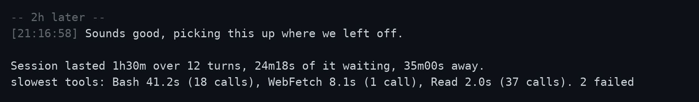
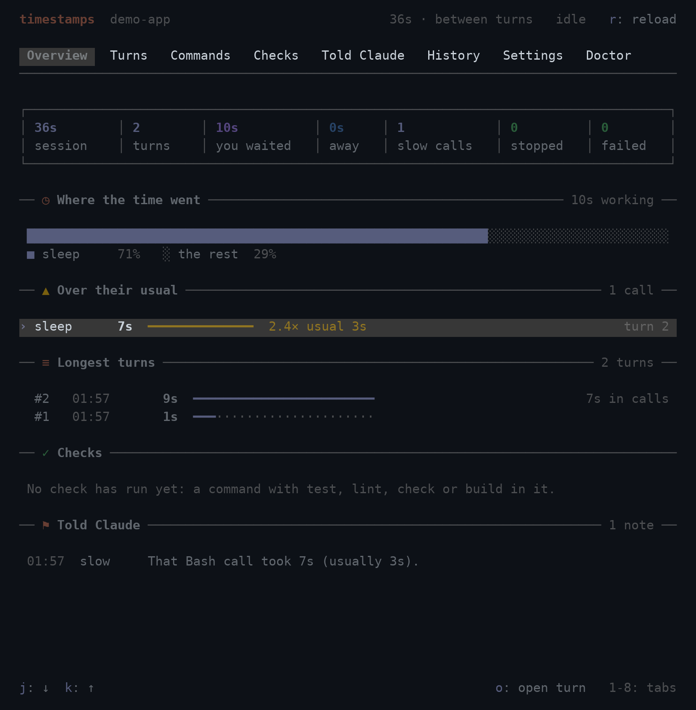
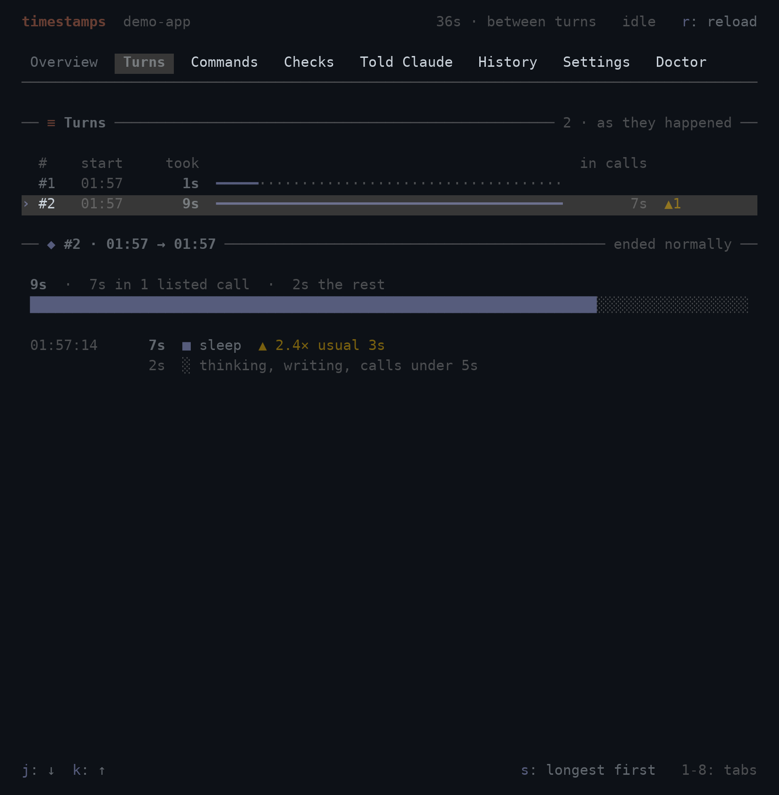
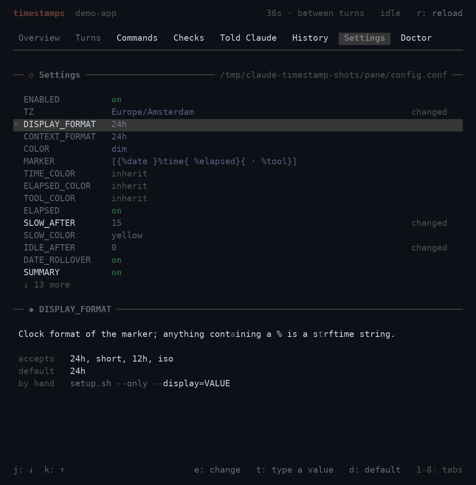

<div align="center">

# Timestamps

**Time awareness for coding agents, in Claude Code and Codex.**

<sub>Formerly Claude Timestamp (`claude-timestamp`), renamed in 0.0.38.</sub>

In Claude Code, every message stamped with the time it happened and how long it took.
The agent hears when a turn runs long, a command is slow, or work resumes after a gap.
At the end, where the session's time actually went.

[](https://github.com/AraneaDev/timestamps/releases)
[](https://aranea.dev/tools/timestamps)
[](https://github.com/AraneaDev/timestamps/actions/workflows/ci.yml)
[](tests/run.sh)
[](docs/troubleshooting.md#platform-notes)
[](https://www.conventionalcommits.org/)
[](./LICENSE)


<sub>Two fast turns render dim. The third crosses the slow threshold, so its duration is coloured and, with `TOOL_TIMING` on, named after the tool that caused it. Tool timing is off by default, so a plain install will not show the tool on its own. A real session, played back at real speed.</sub>

</div>

---

A coding agent has no clock. It cannot tell a two-minute turn from a
forty-minute one, does not know the test suite always takes four minutes, and
picks up yesterday's work as if no time had passed. Timestamps gives it
that sense of time, and shows you the same numbers.

There is nothing to set up. The defaults work as soon as it is installed.

## What you get

### On your screen

In Claude Code, every assistant message carries the local time and how long
the turn took, from the moment you pressed enter to the moment the reply
appeared. A slow turn changes colour, and a gap between messages is marked, so
a session you return to the next morning still reads in order. On exit you get
the totals.

```text
Session lasted 1h30m over 12 turns, 24m18s of it waiting, 35m00s away.
slowest tools: Bash 41.2s (18 calls), WebFetch 8.1s (1 call), Read 2.0s (37 calls). 2 failed
```

Waiting and away never cover the same seconds, so together they add up to no
more than the session. The second line appears with `TOOL_TIMING` on.

<p align="center">
  
</p>

While a turn runs, a dim label in the footer counts it up
(`⏱ 1m12s · session 1h03m`). When a command runs past its usual time, the
line under it says so (`1m10s · usually ~40s · ctrl+b to run in background`),
and any other slow tool gets a line above the prompt. Nothing new appears for
a quick turn. Claude Code only, and display only: Claude is told nothing more.

### What the agent is told

The agent receives the time each prompt was sent, a short note when a turn
runs long, a tool call is slow or a command was stopped at its time limit, how
long ago a project or conversation was last active, and its own timeline after
a compaction. After a commit, a push or a pull request it is told which of the
checks it ran have failed or have had files change since. A bundled skill
tells it what each note is a reason to do, and lets it answer "how long has
this session run?" from measurement. See [What Claude is told](docs/agent-notes.md).

```text
That Bash call was stopped at its 2m00s limit (finishes in ~2m16s when it does).
Before this commit: bash tests/run.sh passed 48m12s ago, 9 files changed since.
```

<p align="center">
  
</p>

### What it learns

Every turn goes into a timeline, and every shell command into a memory of how
long it usually takes in this project. A new session starts with the slow ones
named, so the agent runs them in the background and waits for CI as long as CI
actually takes.

```text
Usually slow in this project: gh run watch ~7m40s (5 runs), bash tests/run.sh ~2m16s (3 runs, 2 more stopped at the 2m00s limit).
That Bash call took 6m10s (usually 4m02s).
```

The memory only keeps what it can vouch for. A call is remembered when one
command in it accounts for the time: `cd app && timeout 300 npm test | tail`
counts as `npm test`, while a chain of two commands, a loop or a script is
left out rather than filed under the wrong name. A run stopped at its limit is
counted apart, since it lasted as long as the limit and not as long as the
command.

### What it does about it

A note sent before a command arrives with its result, too late to stop it
being cut off. So where the memory shows a call's time limit is too short, the
plugin raises that limit before the call runs, and tells the agent it did.
It only ever raises a limit, never touches the command, and never approves a
call for you. `RAISE_LIMIT=off` switches it off.

```text
Timestamps raised this call's limit from 2m00s to 3m30s: bash tests/run.sh has taken up to 2m16s here.
```

### Where your time went

In Claude Code, `/timestamps` opens a pane beside the conversation: the
session at a glance, then turn by turn. It shows which calls took the time,
which ran well over their usual, which were stopped or failed, how your checks
stand, and every note the agent was sent. It also holds the settings, each
changed with a key and no turn of the model, and the doctor. Eight tabs, a
marker you move with `j` and `k`, and it follows the session while it runs. See
[the pane](docs/reports.md#the-pane).

<p align="center">
  
</p>

<p align="center">
  
</p>

Finished sessions are logged, and `--stats` adds them up: how long, how much of
it waiting and how much away, and, when you turn those on, per project and per
tool. See [Reports and history](docs/reports.md).

<p align="center">
  
</p>

## Install

It needs `bash` and `jq`.

**Claude Code**

<!-- aranea-install:start -->
Install from the Aranea marketplace:

```sh
claude plugin marketplace add https://github.com/AraneaDev/aranea-marketplace
claude plugin install timestamps@aranea
```
<!-- aranea-install:end -->

Start a new session afterwards: hooks are bound when a session starts.

Installed as `claude-timestamp` before 0.0.38? Uninstall that first: see
[Upgrading from `claude-timestamp`](docs/install.md#upgrading-from-claude-timestamp).

**Codex**

```bash
codex plugin marketplace add AraneaDev/timestamps
codex plugin add timestamps@aranea
```

Start a new session afterwards, and trust the plugin's hooks when Codex asks.

For installing `jq` and for Windows with WSL, see [Install](docs/install.md).

## Works in

Claude Code in the terminal, the IDE extensions and the **Code** tab of the
desktop app, and Codex. What works depends on the client, not on the model.
Checked against Claude Code and Codex CLI 0.154.0.

| Feature | Claude Code | Codex | Note |
| --- | :---: | :---: | --- |
| Timestamp marker on each message | ✓ | ✗ | Codex has no event for drawing on a message |
| Idle divider and slow-turn colour | ✓ | ✗ | Drawn by the same marker |
| Live turn clock in the footer | ✓ | ✗ | Needs a Claude Code build with hooks modules; `LIVE=off` hides it |
| `/timestamps` pane: a dashboard of where the session's time went | ✓ | ✗ | Needs a Claude Code build with hooks modules; `LIVE=off` removes its call detail |
| A slow tool's time, live, beside its usual time | ✓ | ✗ | Same; Codex has no module support |
| Prompt time told to Claude | ✓ | ✓ | |
| Turn-length and slow-tool notes | ✓ | ✓ | Codex timings are whole seconds |
| Resumption note, for a project or a conversation | ✓ | ✓ | |
| Note after a compaction | ✓ | ✓ | |
| Command memory and the usually-slow note | ✓ | ✓ | |
| A call stopped at its time limit told apart from a failed one | ✓ | ✗ | Read from Claude Code's own report of the call |
| A time limit raised before the call is stopped | ✓ | ✗ | `RAISE_LIMIT`; changes the call's `timeout` and nothing else |
| Stale and failed checks named after a commit | ✓ | ✓ | `CHECK_NOTE`; counts changed files in a Git work tree |
| Turn timeline, `--turns` | ✓ | ✓ | |
| A turn that ends in an API error recorded as `error` | ✓ | ✗ | Codex has no `StopFailure` event |
| Session summary at exit | ✓ | ✓ | Recorded in the history; `codex exec` does not display it |
| History and `--stats` | ✓ | ✓ | |
| `time-awareness` skill | ✓ | ✓ | |
| `/timestamps:configure` command | ✓ | ✗ | Codex uses the `settings` skill or `setup.sh` |

The **Chat** and **Cowork** tabs of the desktop app are not Claude Code and
have no hooks, so nothing here reaches them. Cloud sessions on the web read
hooks from the repository and from managed settings rather than from your
`~/.claude`, so a personal install does not apply there either.

## Configure

Open `/timestamps settings` in Claude Code to change any setting with a key,
or run `/timestamps:configure` to pick a timezone, a clock format, a colour
or a preset; it takes effect on the next message. Every setting, the marker's
layout, colours and per-project settings are in
[Configuration](docs/configuration.md).

<p align="center">
  
</p>

In Codex, use the bundled `settings` skill or `hooks/scripts/setup.sh` to change settings. The visual message marker remains specific to Claude Code.

## Documentation

- [Install](docs/install.md): requirements, both clients, Windows and WSL.
- [Configuration](docs/configuration.md): the Settings tab, `/timestamps:configure`, the marker's layout, colours, every setting.
- [What Claude is told](docs/agent-notes.md): every note the agent receives, and the skill.
- [Reports and history](docs/reports.md): `--session`, `--turns`, `--commands`, `--stats`.
- [Troubleshooting](docs/troubleshooting.md): when something is wrong, platform notes.
- [How it works](docs/how-it-works.md): the hooks, what they cost, and why.
- [Contributing](CONTRIBUTING.md): setup, checks, screenshots, releases.

## Further reading

- [Your Claude Code session has no clock](https://tim-schipper.nl/en/blog/claude-code-timestamps)

## License

MIT

---

Built by [Tim Schipper](https://tim-schipper.nl/en) and released as open source under
[aranea.dev](https://aranea.dev).
