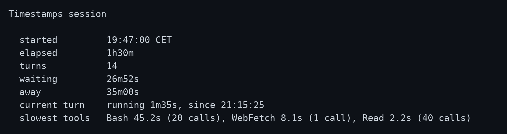

# Reports and history

Part of the Timestamps documentation. Start at the [README](../README.md).

Ask Claude how long you've been at this, or how much of it was waiting, and it
answers in the chat, no command needed. The `time-awareness` skill runs one of
the two reports below and answers from its numbers: `--session` for the
session you are in, `--stats` for the ones already recorded.

For a terminal view, run the script instead:

```bash
bash "$CLAUDE_PLUGIN_ROOT/hooks/scripts/setup.sh" --stats
```

<p align="center">
  
</p>

Each finished session is appended to the history file, and the oldest are
dropped once there are more than `HISTORY_LIMIT` of them.

The file holds timings only: five numbers and a date per session. The date is
in whatever timezone you pinned, the same one the markers use, so a session you
watched happen on the 22nd is recorded on the 22nd. No message text, no tool
arguments, and no paths. With `PROJECTS=on` each row also carries the project's
directory name, never the path above it, and with `TOOL_TIMING=on` a list of
which tools took how long. Switch the record off entirely with `HISTORY=off`.

With those two settings on, the same file answers which project took the week
and which tool took the waiting:

```bash
bash "$CLAUDE_PLUGIN_ROOT/hooks/scripts/setup.sh" --stats --since=7d
bash "$CLAUDE_PLUGIN_ROOT/hooks/scripts/setup.sh" --stats --project=timestamps
```

`--stats` only sees sessions that have already ended. For the one still
running, `--session` reports how long this session has run, from inside
Claude Code:

```bash
bash "$CLAUDE_PLUGIN_ROOT/hooks/scripts/setup.sh" --session
```

`--turns` lists the session one turn at a time: when each started, how long it
took, and, with `TOOL_TIMING` on, which tool took most of it. Add `--json` to
`--session` or `--turns` for the same data in a form a script, or Claude, can
read.

```bash
bash "$CLAUDE_PLUGIN_ROOT/hooks/scripts/setup.sh" --turns
bash "$CLAUDE_PLUGIN_ROOT/hooks/scripts/setup.sh" --session --json
```

## The timeline pane

In Claude Code, `/timeline` opens a pane beside the conversation that shows
where the session's time went, turn by turn: when each turn started, how long
it took, and under it the calls that took five seconds or more, longest
first.

```text
s: longest first  r: read again
9 turns · 2h31m working · since 17:35
#7  18:34  28m41s · 9m32s in 8 listed calls
    1m11s  bash tests/run.sh  usually 1m05s
#8  19:10  29m45s · 11m02s in 6 listed calls
    2m47s  bash tools/check-docs.sh  ▲ 2.5× usual 1m07s
    2m00s  bash tests/run.sh  ■ stopped at its limit
    1m27s  Bash, several commands
   18m43s  the rest: thinking, writing, calls under 5s
#9  19:41  20s
```

A call is marked when it ran one and a half times its usual time here or
more, when it was stopped at its limit, and when it failed. A chain of
commands has no single name, so it is listed as several commands; a call made
by a subagent says so. "The rest" is the turn's time less its listed calls,
and is left out when calls ran side by side and add up to more than the turn.

With the pane focused (ctrl+x tab), `s` switches between the order the turns
happened in and longest first, and `r` reads the session again; the arrows
scroll. `/timeline longest` opens it longest first. The pane updates when a
turn ends.

It draws what the hooks recorded and records nothing itself. The calls come
from a per-session list the tool hook keeps while `LIVE` is on and any of the
settings that keep that hook awake is (the notes, `COMMAND_MEMORY`,
`CHECK_NOTE` or `TOOL_TIMING`); with all of those off the pane still shows
the turns. Like the command memory, the list holds a short key per call,
never the command line, and it is cleared when the session ends.

`--session` also lists the checks run in the session, newest first: when each
ran, how it ended, and how many files in the work tree have changed since.
`--session --json` carries them as `checks`, with `changed` null where it is
not known.

`--commands` shows what the duration memory knows: how long each Bash command
usually takes in this project, from its last 20 runs, how many of them failed
and how many were stopped at their time limit. A stopped run is counted in its
own column and left out of the median, because it lasted as long as the limit
and not as long as the command. Commands are stored by
a short key, the program and at most two plain arguments (`npm test`,
`bash tests/run.sh`): never the full command line, quoted text, a flag, a URL,
a host, an absolute or home path, or anything `echo` and `printf` print. Long
token-shaped words are dropped too, but a short secret typed as a bare
argument can still end up in a key, so prefer an environment variable or a
file for those.

A call is remembered only when one command in it can have taken the time.
Setup and status reports around it are ignored (`cd`, `export`, `source`,
`echo`, `true`), and `timeout`, `nohup` and `stdbuf` are seen through, so
`cd app && timeout 300 npm test | tail -5` counts as `npm test`. A chain of
two commands, a loop, a multi-line script, `xargs` and `bash -c '...'` are not
remembered: one call has one duration, and the report would rather miss a
command than time the wrong one.

The file is `~/.claude/claude-timestamp-commands-v2.tsv`; `COMMAND_MEMORY=off`
stops recording, and deleting the file forgets everything. The memory kept by
earlier versions named the wrong command for chains and could not be
corrected, so it is not carried over; its file,
`~/.claude/claude-timestamp-commands.tsv`, is removed when a session ends.

```bash
bash "$CLAUDE_PLUGIN_ROOT/hooks/scripts/setup.sh" --commands
bash "$CLAUDE_PLUGIN_ROOT/hooks/scripts/setup.sh" --commands --project=all
```

<p align="center">
  
</p>
