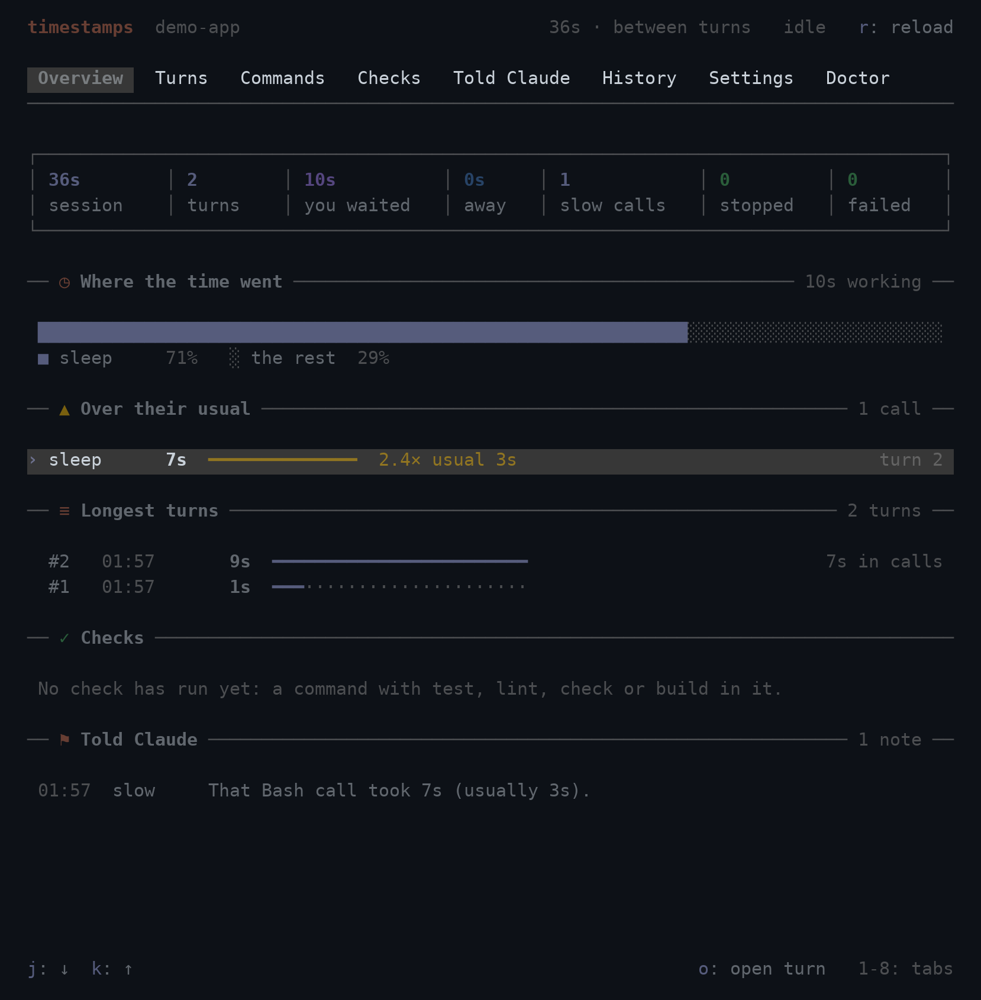

# Reports and history

Part of the Timestamps documentation. Start at the [README](../README.md).

Ask Claude how long you've been at this, or how much of it was waiting, and it
answers in the chat, no command needed. The `time-awareness` skill runs one of
the two reports below and answers from its numbers: `--session` for the
session you are in, `--stats` for the ones already recorded.

For a terminal view, run the script instead:

```bash
bash "$CLAUDE_PLUGIN_ROOT/hooks/scripts/setup.sh" --stats
```

<p align="center">
  
</p>

Each finished session is appended to the history file, and the oldest are
dropped once there are more than `HISTORY_LIMIT` of them.

The file holds timings only: five numbers and a date per session. The date is
in whatever timezone you pinned, the same one the markers use, so a session you
watched happen on the 22nd is recorded on the 22nd. No message text, no tool
arguments, and no paths. With `PROJECTS=on` each row also carries the project's
directory name, never the path above it, and with `TOOL_TIMING=on` a list of
which tools took how long. Switch the record off entirely with `HISTORY=off`.

With those two settings on, the same file answers which project took the week
and which tool took the waiting:

```bash
bash "$CLAUDE_PLUGIN_ROOT/hooks/scripts/setup.sh" --stats --since=7d
bash "$CLAUDE_PLUGIN_ROOT/hooks/scripts/setup.sh" --stats --project=timestamps
```

`--stats` only sees sessions that have already ended. For the one still
running, `--session` reports how long this session has run, from inside
Claude Code:

```bash
bash "$CLAUDE_PLUGIN_ROOT/hooks/scripts/setup.sh" --session
```

`--turns` lists the session one turn at a time: when each started, how long it
took, and, with `TOOL_TIMING` on, which tool took most of it. Add `--json` to
`--session` or `--turns` for the same data in a form a script, or Claude, can
read.

```bash
bash "$CLAUDE_PLUGIN_ROOT/hooks/scripts/setup.sh" --turns
bash "$CLAUDE_PLUGIN_ROOT/hooks/scripts/setup.sh" --session --json
```

## The pane

In Claude Code, `/timestamps` opens a pane beside the conversation, and closes
it again. It shows where the session's time went, on six tabs:

| Tab | What it shows |
| --- | --- |
| Overview | The session at a glance: how long it has run, how many turns, how long you waited and were away, how many calls were slow, stopped or failed; where the working time went as one bar; the calls that ran well over their usual time; the longest turns; the checks; the last notes sent to Claude |
| Turns | Every turn with its start, its length and the time its listed calls took, and beside it the marked turn: its calls in the order they ran, each with its usual time, and what no call accounts for |
| Commands | This project's command memory: runs, usual time, longest run, how often a command was stopped or failed, and the marked command's runs in this session |
| Checks | Each check run this session, how it ended and how many files have changed since |
| Told Claude | Every note the plugin sent Claude this session, newest first: slow and stopped calls, raised limits, stale checks, turn length, and what it said at session start |
| History | Finished sessions by day (time, how long you waited, turns) and by project when `PROJECTS` is on |

<p align="center">
  
</p>

<p align="center">
  
</p>

<sub>A real session, recorded as it happened. The command memory was told
beforehand that `sleep` usually takes three seconds, so the seven-second call
the session made is one that ran over its usual time.</sub>

A call is listed when it took five seconds or more, or was stopped at its
limit. It is marked `▲` when it ran one and a half times its usual time or
more, `■` when it was stopped at its limit and `✗` when it failed. A chain of
commands has no single name, so it is listed as several commands; a call made
by a subagent says so. "The rest" is a turn's time less its listed calls, and
is left out when calls ran side by side and add up to more than the turn.

Give the pane the keys with ctrl+x tab. Then:

| Key | What it does |
| --- | --- |
| `1` to `6` | Open a tab |
| `j`, `k` | Move the marker down and up |
| `o` | On the overview, open the marked turn on the Turns tab |
| `s` | On Turns and Commands, change the order of the list |
| `r` | Read the session again |

`/timestamps turns`, or any tab's name or the start of it, opens the pane on
that tab. The pane is read again when a turn ends, and every few seconds while
one runs. It is drawn on the terminal's own background, and in a narrow
terminal the list and its detail stack instead of sitting side by side.

It draws what the hooks recorded and records nothing itself: one run of
`setup.sh --pane`, which prints everything above as JSON and can be run by
hand. The slow calls and the notes come from two per-session lists the hooks
keep while `LIVE` is on and any of the settings that keep the tool hook awake
is (the notes, `COMMAND_MEMORY`, `CHECK_NOTE` or `TOOL_TIMING`); with all of
those off the pane still shows the turns. Like the command memory, the list of
calls holds a short key per call, never the command line, and both lists are
cleared when the session ends.

`--session` also lists the checks run in the session, newest first: when each
ran, how it ended, and how many files in the work tree have changed since.
`--session --json` carries them as `checks`, with `changed` null where it is
not known.

`--commands` shows what the duration memory knows: how long each Bash command
usually takes in this project, from its last 20 runs, how many of them failed
and how many were stopped at their time limit. A stopped run is counted in its
own column and left out of the median, because it lasted as long as the limit
and not as long as the command. Commands are stored by
a short key, the program and at most two plain arguments (`npm test`,
`bash tests/run.sh`): never the full command line, quoted text, a flag, a URL,
a host, an absolute or home path, or anything `echo` and `printf` print. Long
token-shaped words are dropped too, but a short secret typed as a bare
argument can still end up in a key, so prefer an environment variable or a
file for those.

A call is remembered only when one command in it can have taken the time.
Setup and status reports around it are ignored (`cd`, `export`, `source`,
`echo`, `true`), and `timeout`, `nohup` and `stdbuf` are seen through, so
`cd app && timeout 300 npm test | tail -5` counts as `npm test`. A chain of
two commands, a loop, a multi-line script, `xargs` and `bash -c '...'` are not
remembered: one call has one duration, and the report would rather miss a
command than time the wrong one.

The file is `~/.claude/claude-timestamp-commands-v2.tsv`; `COMMAND_MEMORY=off`
stops recording, and deleting the file forgets everything. The memory kept by
earlier versions named the wrong command for chains and could not be
corrected, so it is not carried over; its file,
`~/.claude/claude-timestamp-commands.tsv`, is removed when a session ends.

```bash
bash "$CLAUDE_PLUGIN_ROOT/hooks/scripts/setup.sh" --commands
bash "$CLAUDE_PLUGIN_ROOT/hooks/scripts/setup.sh" --commands --project=all
```

<p align="center">
  
</p>
